# Documentation visual conventions

<!-- delivery-version: c35418343fe8896348732bd54f8256de17338f8d 2026-11-07T14:33:16+01:00 -->

This reference is the authoring convention for Mermaid diagrams in AIS CR documentation.
It is the source an author consults when deciding whether a diagram belongs in a durable document, how the diagram coexists with prose, and which Mermaid families GitHub actually renders.

## Scope

- Applies to durable documents: governance stems and their delivered readers, canonical references, capability specs, workflow bodies, root governance docs, README pairs, and equivalent committed delivery surfaces.
- Time-stamped reports, transient session artefacts, and runtime or cache trees are out of scope.
- Receiving this reference does not by itself change any existing document.
  It states how a diagram should be authored when one is added or revised.

## When Mermaid is appropriate

Add a Mermaid block only when all of the following hold:

- The material is a dense process, authority model, lifecycle, sequence, state, or data-flow explanation.
- A small diagram materially shortens or clarifies the explanation relative to prose alone.
- The diagram will stay paired with a short adjacent prose summary or bullets that state the same operational meaning in text.

Reject Mermaid when any of the following hold:

- The diagram is decorative and does not clarify dense structure or flow.
- The diagram would become the primary owner of meaning (prose-first authority is a repo invariant).
- The material is already clear in prose and a diagram would only duplicate it.

## Diagram plus prose is mandatory

Every Mermaid block MUST keep a short adjacent prose summary or bullets that state the same operational meaning in text.

- Prose may precede or follow the Mermaid block.
- Prose MUST restate the same operational meaning in text; a pure caption is not enough.
- Prose SHOULD be short — a few sentences or bullets; a second full narrative restatement is not required.

A Mermaid block without adjacent prose is an incomplete doc change and must be rejected in review.

## Choosing a Mermaid family

There is no gated family list.
Any core Mermaid family that GitHub renders may be used, chosen to fit the material.
Family choice is a judgment aid, not a permission gate; the two rules that always bind are that the diagram renders on GitHub and that it stays paired with prose.

Two facts constrain the choice:

- GitHub renders the **core** Mermaid build.
  Families that require a third-party plugin do not render there and are unsupported; `zenuml` is the only such family in the official set and MUST NOT be used.
- GitHub's deployed Mermaid version advances independently of this repo's.
  The repo aligns its parser to that version; the alignment requirement is owned by `openspec/specs/documentation/documentation-visual-conventions/spec.md`, and the probe procedure and observed version are recorded below.
  Parsing is a syntax check; authors still review the rendered result.

### Version alignment and probe

The repo moved from Mermaid **11.16.1** to **12.1.0** after the operator's GitHub `info` probe on **2026-10-09**.
On **2026-10-10**, an independent read of the [GitHub renderer entry](https://viewscreen.githubusercontent.com/markdown/mermaid) and its [served JavaScript asset](https://viewscreen.githubusercontent.com/static/assets/mermaidMarkdown-87477f4cef49418a818e.js) confirmed that the deployed renderer passes **12.1.0** to Mermaid's drawing routine.
The manifest, lockfile, and installed parser agree with that version; no version divergence was observed.
This confirms the deployed bundle version, not the appearance of every family.

When reviewing or changing the pin:

1. In a GitHub Markdown preview, render a `mermaid` code fence whose only body line is `info`.
   Read the version displayed by that diagnostic diagram, following [GitHub's version-check instructions](https://docs.github.com/en/get-started/writing-on-github/working-with-advanced-formatting/creating-diagrams#checking-your-version-of-mermaid).
2. Compare that observed version with `package.json`, `package-lock.json`, and the installed `mermaid` package.
   A local `info` diagram reports the local parser's version and does not establish GitHub's version.
3. Record the observation date, source, old and new versions, and any outstanding divergence in this section.
   Attribute an operator observation as such; do not describe it as an independently reproduced probe.
4. If the versions differ, refresh the pin through an approved toolchain change, including any required Node engine and CI adjustments.
   Consult the [official Mermaid diagram index](https://mermaid.js.org/intro/) at the adopted version and reconcile the advisory table and samples when the core family set changes.
5. Reinstall the pinned dependencies and run `npm run validate:mermaid` and the toolchain version-agreement and installed-pin checks.
   Review GitHub rendering and companion prose separately.

The table below is advisory guidance per family.
The samples after it show each family in practice.

| Mermaid family | Renders on GitHub | Best for | Watch out |
| --- | --- | --- | --- |
| `flowchart` | Yes | Process, routing, load order, authority flow. | Label edges where logic branches. |
| `sequenceDiagram` | Yes | Short cross-role or tool-interaction sequences. | Keep participants and messages few; leave details in prose. |
| `stateDiagram-v2` | Yes | Lifecycle and approval-boundary material. | Name transitions; keep states mutually exclusive. |
| `classDiagram` | Yes | Static component or type relationships. | Do not model runtime sequence here. |
| `erDiagram` | Yes | Registry or asset-relation structure. | Keep to the entities the document discusses. |
| `gantt` | Yes | Staged rollout or schedule-like material. | Dates age; state the intent in prose too. |
| `pie` | Yes | A single share-of-whole split. | Low value for governance; use only when the split is the point. |
| `quadrantChart` | Yes | Positioning or scoring on two axes. | Axis choice is opinionated; justify it. |
| `requirementDiagram` | Yes | Requirement-traceability relationships. | Best in OpenSpec-heavy documents. |
| `gitGraph` | Yes | Branch or merge topology. | Overlaps Git tooling; use only when history shape matters. |
| `C4Context` | Yes | System-context and boundary views. | Keep one level; `C4Context`/`C4Container` are the usual subtypes. |
| `mindmap` | Yes | Taxonomy or family overviews. | Deep nesting renders wide. |
| `timeline` | Yes | Historical or phased summaries. | Keep milestones few and dated. |
| `journey` | Yes | User-journey framing. | Often decorative in governance material; use sparingly. |
| `sankey` | Yes | Flow or volume between stages. | Needs real volumes, not guesses. |
| `xychart` | Yes | Quantitative series. | Rare in governance docs; only with real data. |
| `block` | Yes | Dense structural layouts. | Beta syntax; `flowchart` often suffices. |
| `packet` | Yes | Byte or field layout. | Niche; rarely warranted here. |
| `kanban` | Yes | Board-style workflow overviews. | A static snapshot only; it does not track state. |
| `architecture` | Yes | System-boundary views. | Beta syntax; `C4Context` is often safer. |
| `radar` | Yes | Multi-axis scorecards. | Beta syntax; encodes opinion. |
| `treemap` | Yes | Hierarchy-plus-size views. | Beta syntax; needs real proportions. |
| `venn` | Yes | Set-overlap relationships. | Beta syntax; rarely justifies itself. |
| `ishikawa` | Yes | Cause analysis for postmortems. | Beta syntax; keep causes evidence-based. |
| `treeView` | Yes | Explicit hierarchy references. | Beta syntax; `flowchart` often suffices. |
| `swimlane` | Yes | Processes whose steps cross responsibility boundaries. | Beta syntax; keep each lane one kind of owner. |
| `usecase` | Yes | Actors and the system capabilities they use. | Beta syntax; declare actors explicitly. |
| `eventmodeling` | Yes | Interfaces, commands, and resulting events. | Beta syntax; distinguish commands from facts that occurred. |
| `wardley` | Yes | Dependencies positioned by visibility and evolution. | Beta syntax; positions are judgments, not measurements. |
| `cynefin` | Yes | Decision contexts and approaches to uncertainty. | Beta syntax; classification needs supporting reasoning. |
| `zenuml` | No — plugin only | — | GitHub does not render third-party plugins; unsupported. |

### Worked samples

Each sample illustrates its family's syntax and keeps companion prose stating the depicted meaning.
Dates, counts, scores, and classifications in the samples are illustrative rather than reports about the ecosystem.

#### `flowchart`

Intake proceeds to planning, then to applying the plan.

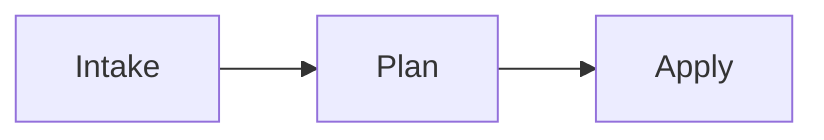

#### `sequenceDiagram`

The operator approves the plan; the agent returns a report to the operator.

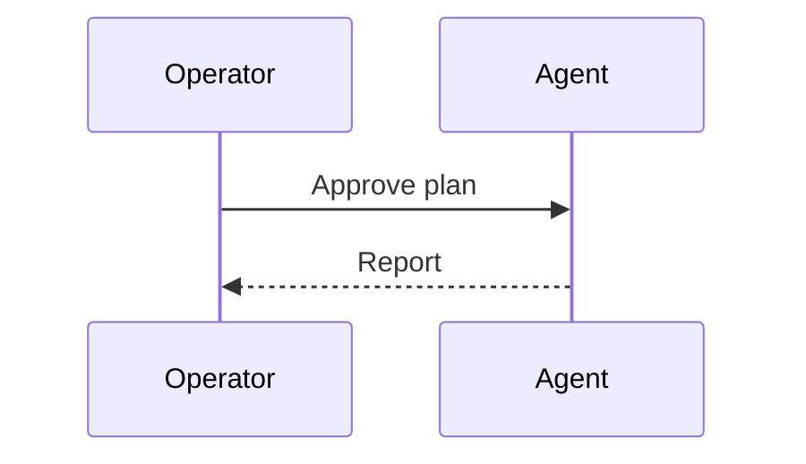

#### `stateDiagram-v2`

A draft enters the approved state after sign-off, then completes its lifecycle.

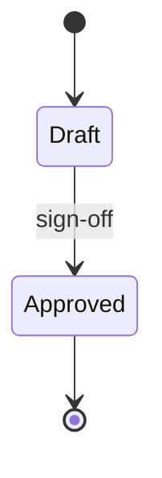

#### `classDiagram`

One requirement relates to multiple scenarios; each scenario relates to one requirement.

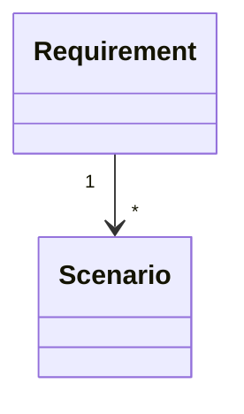

#### `erDiagram`

A change carries zero or more requirements, and each requirement belongs to one change.

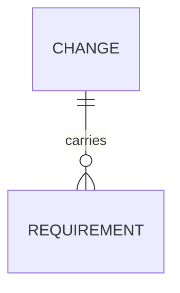

#### `gantt`

The illustrative hub rollout contains one authoring stage starting on 2026-01-01 and lasting 30 days.

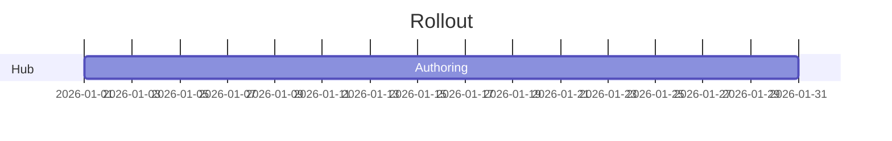

#### `pie`

The illustrative total consists of five flowchart diagrams and three sequence diagrams.

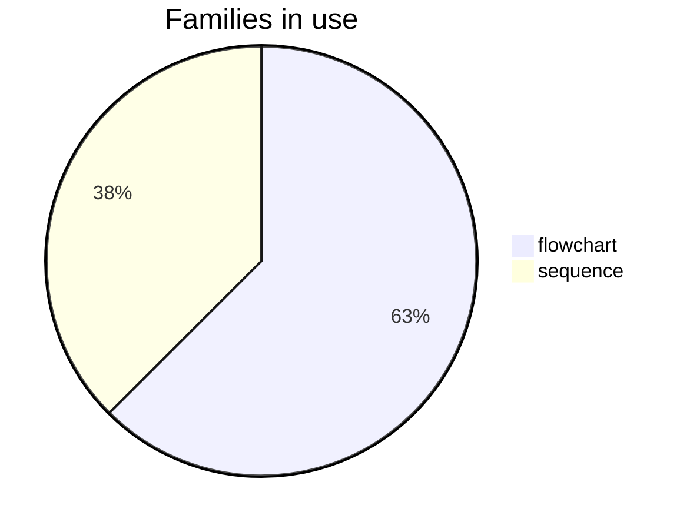

#### `quadrantChart`

The illustrative proposal sits at effort 0.3 and value 0.8, within the quadrant labeled Plan.

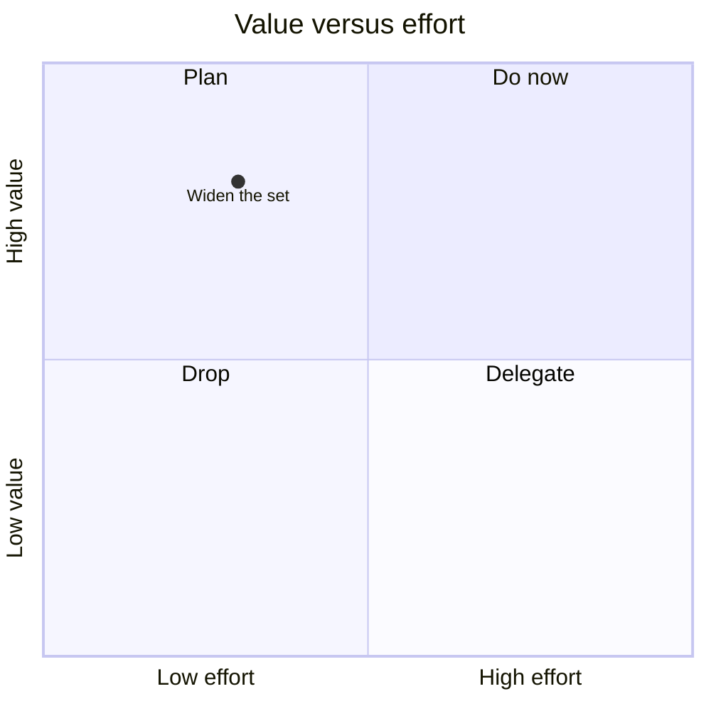

#### `requirementDiagram`

Requirement 1 states that prose owns meaning; its risk is low and verification uses inspection.

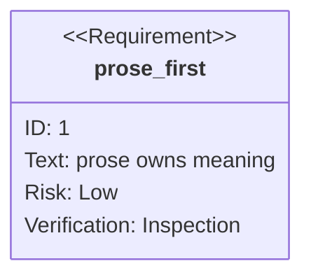

#### `gitGraph`

A feature branch starts from the base commit, receives the work commit, and merges into main.

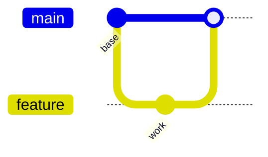

#### `C4Context`

The operator uses the management hub to run workflows.

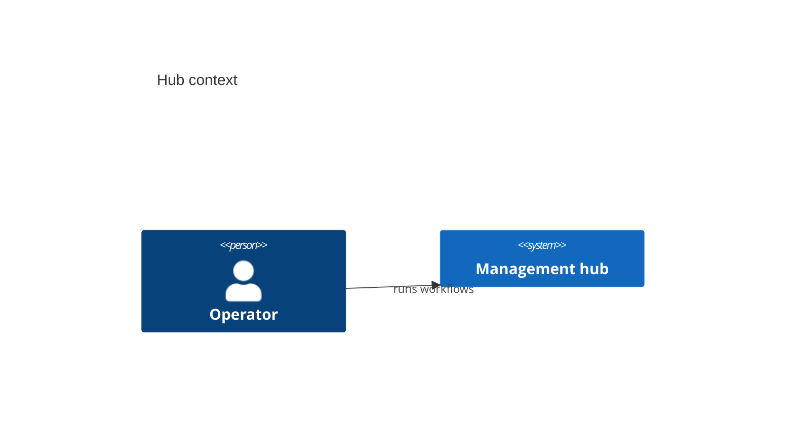

#### `mindmap`

The taxonomy groups flowchart and sequence diagrams under Flow, and timeline and Gantt diagrams under Time.

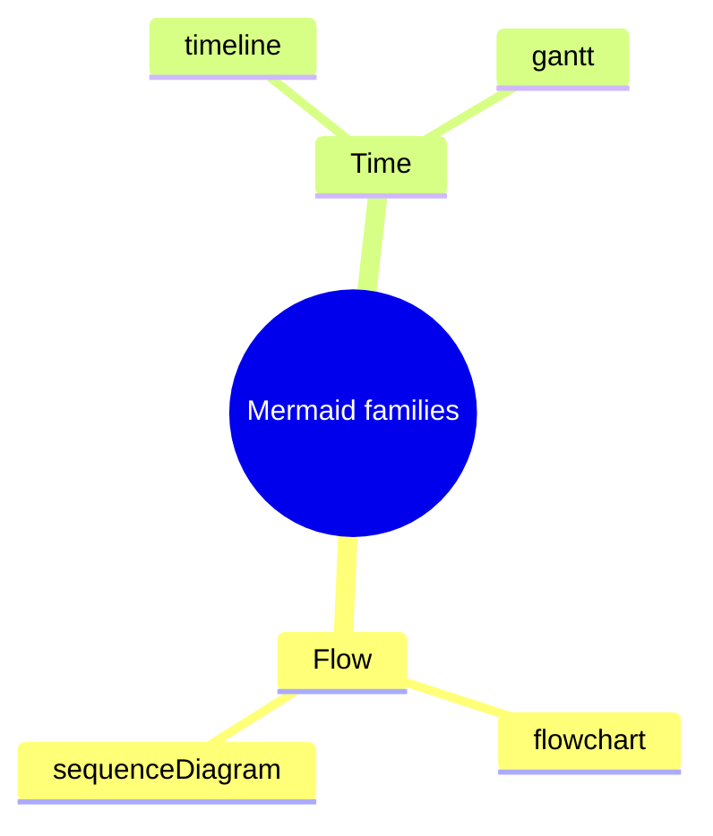

#### `timeline`

The illustrative rollout authors hub rules in 2025, adopts OpenSpec in 2026, and delivers sibling bundles in 2026.

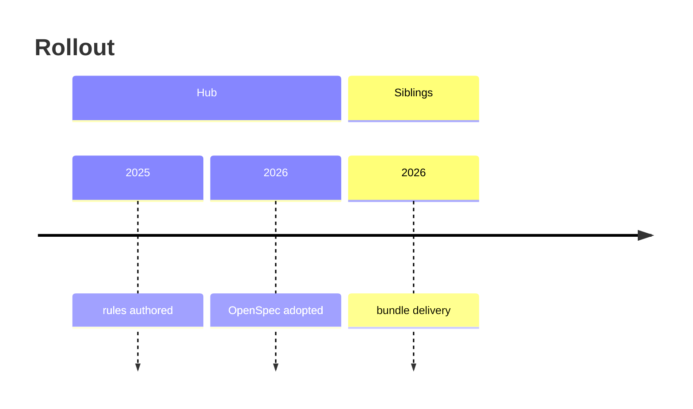

#### `journey`

The author selects a family and writes its fence; the reviewer then confirms the prose companion.
The illustrative scores for these steps are 4, 5, and 3.

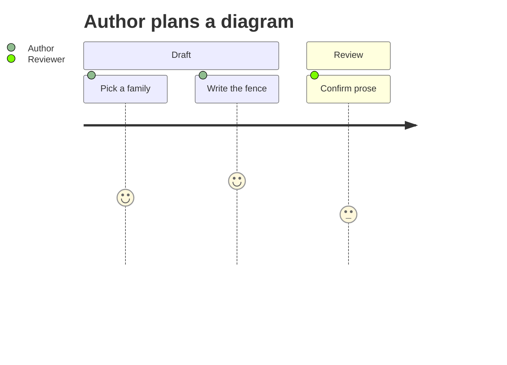

#### `sankey`

The illustrative hub flow sends eight units to siblings and four units to the archive.

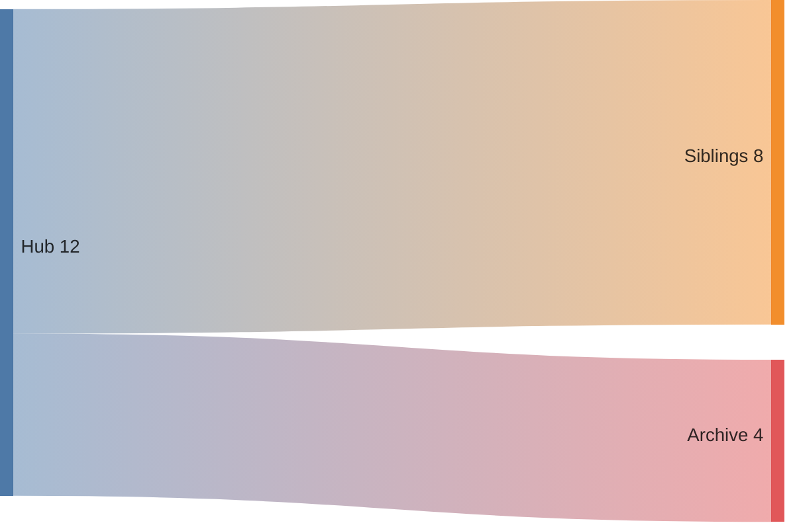

#### `xychart`

The illustrative fence counts are eight for rules, six for references, five for specs, and three for READMEs.

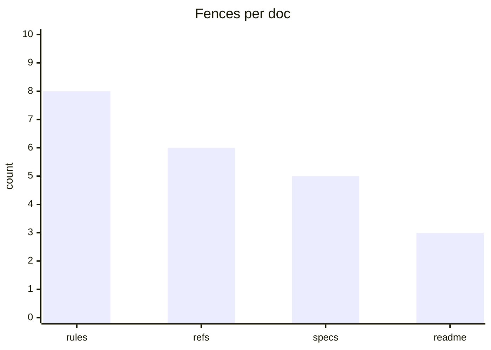

#### `block`

Collect, Plan, and Apply appear side by side in a three-column layout.

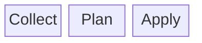

#### `packet`

Byte 0 occupies bit positions 0-7; byte 1 occupies positions 8-15.

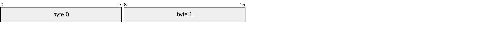

#### `kanban`

Widen the set is in Backlog, while Samples added is in Done; this is an illustrative board snapshot.

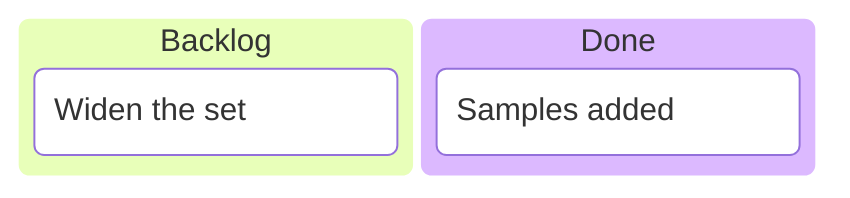

#### `architecture`

Read and Write are services within the Hub group, with a connection from Read's right side to Write's left side.

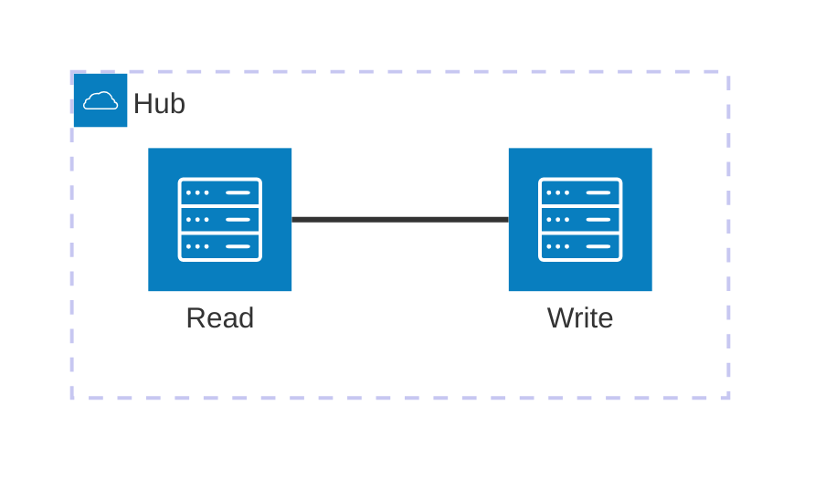

#### `radar`

The illustrative set scores 1 on axis A, 2 on axis B, and 3 on axis C.

```mermaid
radar-beta
  title Coverage
  axis a["A"], b["B"], c["C"]
  curve plot["set"]{1, 2, 3}
```

#### `treemap`

The illustrative Hub total is 100, with child values of 40 for rules and 30 for references.

```mermaid
treemap-beta
  "Hub": 100
    "rules": 40
    "refs": 30
```

#### `venn`

The Rules and References sets overlap in the region labeled Both.

```mermaid
venn-beta
  title "Rules and references overlap"
  set Rules
  set References
  union Rules,References["Both"]
```

#### `ishikawa`

The illustrative effect Blame has two proposed contributing causes: Cause one and Cause two.

```mermaid
ishikawa-beta
  title Root causes
  Blame
    Cause one
    Cause two
```

#### `treeView`

The root contains two children: governance and references.

```mermaid
treeView-beta
  root
    governance
    references
```

#### `swimlane`

The operator owns approval and the agent owns application; the arrow hands work from the operator to the agent.

```mermaid
swimlane-beta LR
  subgraph Operator
    approve[Approve plan]
  end
  subgraph Agent
    apply[Apply plan]
  end
  approve --> apply
```

#### `usecase`

The operator uses the Preview change capability within the Hub system boundary.

```mermaid
usecase-beta
direction LR
actor Operator
systemBoundary Hub
  Preview("Preview change")
end
Operator --> Preview
```

#### `eventmodeling`

The illustrative review flow starts at ReviewScreen, issues an ApprovePlan command, and records a PlanApproved event.
The command and event each carry a change identifier.

```mermaid
eventmodeling
tf 01 ui ReviewScreen
tf 02 cmd ApprovePlan { change: string }
tf 03 evt PlanApproved { change: string }
```

#### `wardley`

The Operator anchor depends on Validation.
Their illustrative positions express visibility and evolution rather than measured performance.

```mermaid
wardley-beta
anchor Operator [0.95, 0.20]
component Validation [0.70, 0.80]
Operator -> Validation
```

#### `cynefin`

The illustrative incident map places Apply known fix in Clear and Investigate unknown cause in Complex.

```mermaid
cynefin-beta
  clear
    "Apply known fix"
  complex
    "Investigate unknown cause"
```

## Authoring checklist

Before merging a doc change that adds or modifies a Mermaid block:

1. The family is a core Mermaid family that GitHub renders (see the advisory table above); `zenuml` is unsupported.
2. The diagram clarifies dense flow, authority, lifecycle, sequence, state, or data-flow material.
3. A short adjacent prose summary or bullet list restates the operational meaning in text.
4. Prose remains the normative owner; the diagram is a supporting aid.
5. The diagram renders under GitHub Flavored Markdown.
6. The diagram parses under this repository's Mermaid validator where one is configured.

Automated validation checks syntax only.
It does not replace author review for prose adjacency, GitHub renderability, or diagram quality.

## At the management hub

The hub-side half of this convention is owned by `openspec/specs/documentation/documentation-visual-conventions/spec.md`, which carries the durable contract: exemplar coverage across hub doc surfaces, the plugin-family rejection, the pinned-version alignment with GitHub's renderer, the committed scan scope, and the pinned-version parse requirement enforced by `npm run validate:mermaid`.
Those obligations bind hub authoring and are not restated here.
