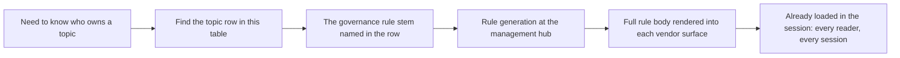

# Governance by Assistant Product – Canonical Rule Map

<!-- delivery-version: b257a1a89279be5e17cda3c133aa77b8c4d2706c 2026-11-07T11:18:12+01:00 -->

**Purpose:** Map policy topics to the governance rule stem that owns each one, so a reader can tell which surface is authoritative for a topic.
Every vendor delivery surface carries the full rule body generated from the matching stem.
This file is a lookup table only.

**This is not a session-time loading map.**
No supported product selects a rule reader by topic: Cursor marks every `.mdc` `alwaysApply: true`, Claude Code injects every `.claude/rules/` reader at session start, Kilo Code loads every `.kilo/rules/*.md` reader through the `instructions` array in `.kilo/kilo.jsonc`, Gemini CLI loads the whole `.gemini/context/` directory through `settings.json` `context.includeDirectories`, every Copilot instruction file declares `applyTo: "**/*"`, and Codex embeds the bodies in `CODEX.md`.
Use this table to decide **who owns a topic**, not to decide what to read into a session — the delivered set is already there.

The ownership diagram below is a scanning aid only.

## Topic -> Canonical Rule Stem

**Scope** says who a row binds.
`All agents` and `Ecosystem` rows name stems delivered to every repository.
Rows whose owner is not `BASELINE` (`Management hub`, `Port/safety`, and any other such scope) sit inside the sibling fence, so a recipient that does not carry that owner does not see them.

<!-- begin:generated:ownership-topics -->
| Topic | Canonical rule source | Scope |
| --- | --- | --- |
| Workspace boundary, sibling repos, config protection | `aiscr-workspace-boundary-safety.md` | All agents |
| OpenSpec adoption posture and work-kind triggers | `aiscr-openspec-posture.md` | All agents |
| Model/runtime metadata in usage logs | `aiscr-model-logging.md` | All agents |
| Agent work-style defaults and pre-presentation self-check Iron Law | `aiscr-quality-first-execution.md` | All agents |
| Repository-qualified GitHub issue and PR citations | `aiscr-quality-first-execution.md` | All agents |
| Planning baseline before non-trivial work | `aiscr-planning-core.md` (*Upstream baseline before significant planning*) | All agents |
| Planning-first execution model and re-plan triggers | `aiscr-planning-core.md` | All agents |
| Usage-log lifecycle, required fields, close-out prompt | `aiscr-usage-logging.md` | All agents |
| Review severity, admissibility, observations, scope, and untrusted input | `aiscr-review-conduct.md` | Reviews |
| Ecosystem-wide shared rules (siblings; workflow alignment) | `aiscr-ecosystem-governance.md` | Ecosystem |
| Hub vs sibling workflow routing | `aiscr-ecosystem-governance.md` (*Hub vs sibling workflow surfaces*) | Ecosystem |
<!-- end:generated:ownership-topics -->

**Delivery surfaces:** Every vendor surface (`.cursor/rules/*.mdc`, `.claude/rules/*.md`, `.kilo/rules/*.md`, `.gemini/context/*.md`, `.github/instructions/*.instructions.md`, generated `CODEX.md` sections) carries the **full rule body** for its stem, preceded by the Entry-scope region — not a summary and not a link to fetch.
Never edit a delivered copy; it is regenerated from the canonical stem at the management hub.
(Rendered template form: `.cursor/rules/<stem>.mdc`, `.claude/rules/<stem>.md`, `.kilo/rules/<stem>.md`, `.gemini/context/<stem>.md`, `.github/instructions/<stem>.instructions.md`.)

**Entry-doc pointers (workspace boundary):** `CLAUDE.md`, `CODEX.md`, and `GEMINI.md` each carry a short workspace-boundary pointer back to `AGENTS.md` and the owning canonical rule.

## What to read, given that the rule set is already loaded

1. Read `AGENTS.md` and `CONTRIBUTING.md`, plus any repository-specific agent guide — these are **not** part of any vendor's automatic rule delivery (Codex is the exception: it receives `AGENTS.md` through its own instruction-file hierarchy).
2. Your tool entry doc (`CLAUDE.md`, `CODEX.md`, `GEMINI.md`, `.github/copilot-instructions.md`) for product-specific behaviour.
3. The delivered rule bodies for your product are already in context — they carry the full rule text, not a pointer to it, so there is nothing further to open for the rule's content.

**Cursor:** primary project context is `AGENTS.md` plus `.cursor/rules/*.mdc`, every one of which is marked `alwaysApply: true`; use `.cursor/README.md` for assistant-specific routing.

