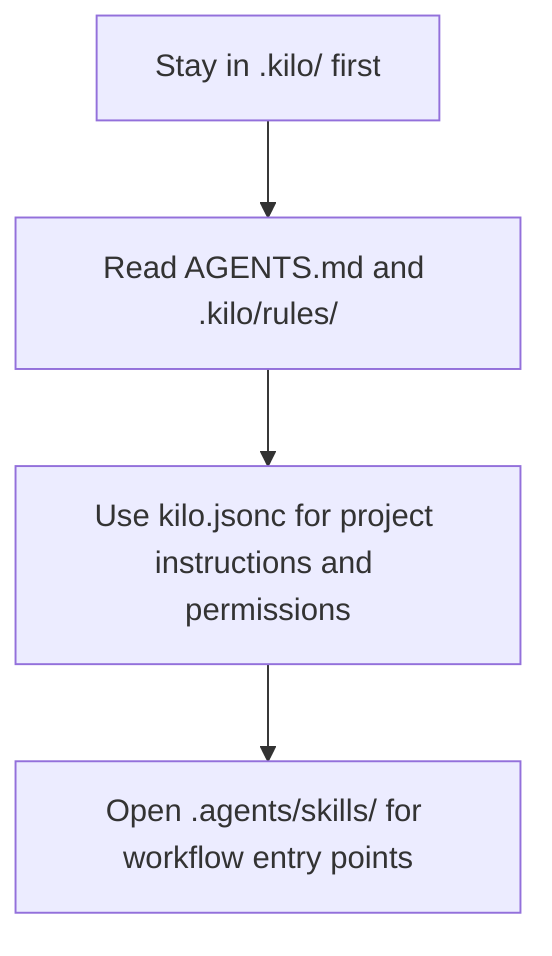

# Kilo Code configuration

<!-- delivery-version: 083eb1bc1a0c628b2d6d48b806b6568be3f67ac2 2026-11-07T12:31:37+01:00 -->

This directory is the **committed hub-root Kilo Code delivery surface** for the AIS CR management hub.
It carries generated rules and subagents plus the project configuration that loads them.
Sibling repositories receive selected assets only through the governed direct-bundle workflow (`inspect` to `plan` to explicitly approved `apply --approve`).

<!-- aiscr:entry-scope -->

The load path below remains a supporting aid; the `Entry scope` and `Read First` sections stay normative.

## Entry scope

- Stay in this `.kilo/` tree and its direct pointers first.
- Do not open parallel vendor trees without a clear parity, generator, or governance-maintenance reason.
- Treat generated files under `rules/` and `agents/` as delivery surfaces; edit their canonical sources instead.

## Read First

- `AGENTS.md`
- `.kilo/rules/`
- `.agents/canonical_configs/references/governance_by_tool.md`

## Notes

- `.kilo/kilo.jsonc` loads the generated rules through its `instructions` array and carries only the governed permission baseline.
  MCP configuration is intentionally omitted because project MCP files can expose secrets.
- Workflow entry points live in the shared `.agents/skills/` tree.
  Do not create a parallel `.kilo/skills/` tree.
- Kilo Code subagents live in `.kilo/agents/` and are generated from the canonical agent definitions.
- A running VS Code window keeps the skill body it loaded at VS Code start, so after pulling changes that affect generated skills or workflow bodies, reload the window before running a workflow.
- Official Kilo documentation for these surfaces is linked from the management hub's vendor matrix registry.
